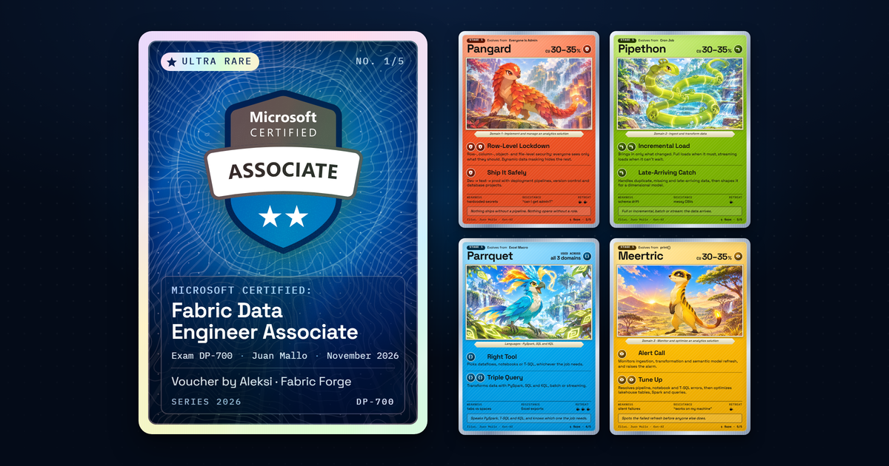

# DP-700 · Card Pack

I passed **DP-700 — Microsoft Certified: Fabric Data Engineer Associate**, so I
turned it into a booster pack: tear it open, confetti bursts, and five
holographic cards come out. The badge card is the ultra rare; the other four
are the exam's three domains plus the languages it is written in, as
creature cards.

**Live:** https://dp700-pack.pages.dev



## Under the hood

### Stack: no framework, no build step

Plain HTML, CSS and JavaScript (native ES modules), served as static files by
Cloudflare Pages from [`site/`](site). About 40 KB of HTML, CSS and JS
(gzipped) for the first paint; the illustrations and sound load after it.

Why no framework: the effect is 2.5D (tilt, foil, glare), which CSS does at
compositor cost. three.js would have meant ~150 KB more JavaScript and more
GPU time on phones for nothing visible. A bundler would save a few KB and
make the deployed code differ from the code below. Everything works offline
from any static server.

```
site/                 ← the deployed site
  index.html          all card text is real HTML (readable, accessible)
  css/                base · pack · card · foil (the holo is pure CSS)
  js/
    clock.js          one clock for everything (live or frame-stepped)
    sequence.js       the choreography: open, reveal, deal, video script
    tilt.js           spring physics → 5 CSS variables per frame
    strip.js          the tear strip as a chain of bending segments
    tear.js           drag / click / keyboard to open
    confetti.js       small, seeded canvas particle system
    zoom.js           crisp zoom of a single card
    sound.js          Web Audio effects + music, muted by default
tools/                ← dev only, never deployed
```

### The holographic foil is just CSS

Each foil surface is a stack of layers over the artwork:

1. **Rainbow** — a `repeating-linear-gradient` with `mix-blend-mode: color-dodge`
   whose `background-position` follows the light.
2. **Glitter** — SVG fractal noise thresholded into sparse specks, masked to
   sparkle only near the light.
3. **Glare** — a radial highlight with `mix-blend-mode: overlay`.

JavaScript never touches pixels. [`tilt.js`](site/js/tilt.js) runs a small
spring towards the pointer (or the phone's gyroscope) and writes five custom
properties per frame: `--rx`, `--ry` (rotation), `--mx`, `--my` (light
position) and `--hyp` (how hard the card is tilted). The CSS does the rest.

The badge card has holo over the whole card; the creature cards only in the
art window, like real trading cards, so their text stays crisp.

### Details that took the longest

- **Sharp text while tilted.** Chrome rasterises `preserve-3d` layers and
  `scale()`d layers at their original size, then stretches them, so tilted or
  zoomed cards turned blurry. Cards are therefore flat 2D layers (the flip
  swaps back and face when the card is edge-on), and zooming re-lays the card
  out at its real size instead of scaling it. Every size inside a card is in
  container units (`cqi`), so it redraws sharp at any size.
- **The tear strip** is ten nested segments; each bends a few degrees once
  the tear passes its joint, so the foil curls instead of rotating like a
  plank. Released, it flies off on a sampled projectile (impulse, gravity,
  spin, flutter).
- **The pack has thickness:** a back face and two side gussets in a 3D shell
  behind a flat front.
- **The "OneLake" contour lines** on the pack and card backs are generated:
  a seeded height field → marching squares → smoothed SVG paths
  ([`tools/gen-topo.mjs`](tools/gen-topo.mjs)).

### One clock, so the video is frame-perfect

Every animation is a Web Animation scheduled up front on one clock
([`clock.js`](site/js/clock.js)); springs, confetti and scripted light sweeps
step at a fixed 240 Hz. With `?auto=1&capture=1` the page freezes and exposes
`window.__seek(t)`, which sets `currentTime` on every animation
(`document.getAnimations()`, CSS keyframes included) and advances the
physics to `t`.

[`tools/record.mjs`](tools/record.mjs) uses Playwright to seek 1/30 s at a
time at 2160×2700 and pipes each screenshot into ffmpeg: no dropped frames,
whatever the machine is doing. The page also logs a cue for every moment
(tear, confetti, each card landing, reveal…), and the recorder mixes the
sound effects at those exact times over the music (`adelay` + `amix`),
normalised to −16 LUFS. The music is 170.6 BPM, so the last part of the
video is laid on its bar grid: each card arrives on a downbeat and the video
ends on one.

### Accessibility

`prefers-reduced-motion` gets a cross-fade with no flight, confetti or tilt.
The pack opens with Enter or Space; Tab moves through the cards; Escape
closes a zoomed card. Card text is real text. Sound is off until you turn it
on.

## Run it locally

```sh
cd tools
npm install                  # Playwright + font subsetter (dev only)
npx playwright install chromium
node serve.mjs               # → http://127.0.0.1:5173  (?auto=1 = video mode)
```

| Command | What it does |
|---|---|
| `node shoot.mjs` | Screenshots at 1440×900, 1080×1350 and 390×844 |
| `node check-frame.mjs` | Checks no card ever leaves the frame, every frame |
| `node record.mjs` | Renders `video/dp700-pack.mp4` (+ 2160×2700 master) |
| `node record.mjs --mix-only` | Redoes only the sound mix |
| `node og.mjs` | Renders the link-preview image and the video cover |
| `node fonts.mjs` | Subsets Space Grotesk to the characters the site uses |
| `node sfx-edit.mjs` | Trims, levels and exports the sound effects |
| `python -I cards-src/build-cards.py` | Writes the four creature cards into the HTML |

## Credits

- **Idea:** inspired by [holo.yashb.xyz](https://holo.yashb.xyz) by
  [@Yassshhu](https://x.com/Yassshhu). Concept only: no code, assets or
  design were reused.
- **Voucher:** Aleksi & Fabric Forge.
- **Card content:** based on the
  [official DP-700 study guide](https://learn.microsoft.com/credentials/certifications/resources/study-guides/dp-700).
  The only number on any card is the real exam weight (30–35%).
- **Badge:** the official Microsoft Certified Associate badge, used by its
  holder. No other Microsoft or Fabric logos are used.
- **Creature illustrations:** generated with AI by me from my own prompts
  ([`tools/art-prompts.md`](tools/art-prompts.md)).
- **Sound effects and music from [Pixabay](https://pixabay.com)** (Pixabay
  Content License). The source files are not redistributed in this repo.
- **Fonts:** Space Grotesk (subset for the site) and IBM Plex Mono (IBM's official
  WOFF2 files, unmodified), both under the SIL Open Font License; licence texts in
  [`site/assets/fonts/`](site/assets/fonts).
- **Built with** [Claude Code](https://claude.com/claude-code).

The creature cards are an affectionate parody of the trading-card genre. They
use their own layout, icons and names, and are not affiliated with any card
game or with Microsoft.
